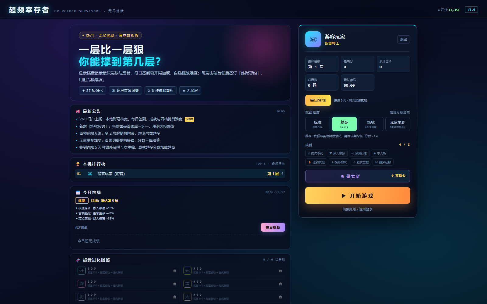
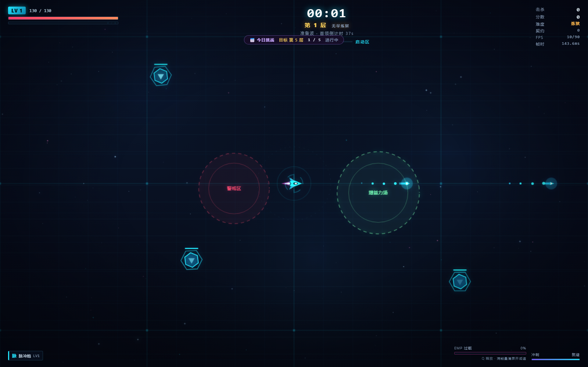
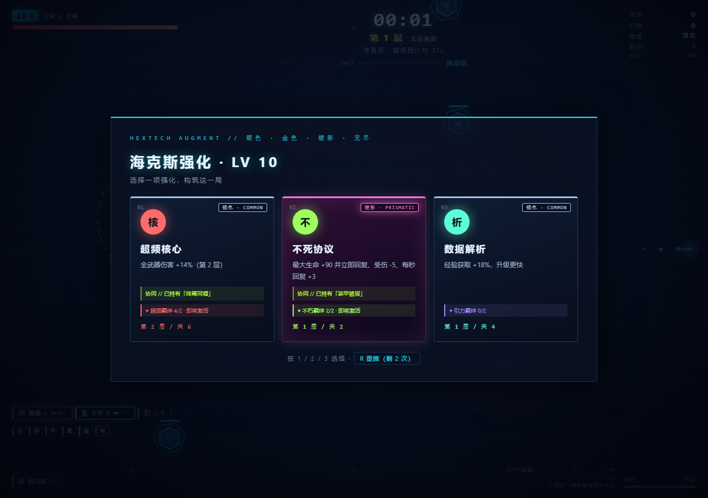
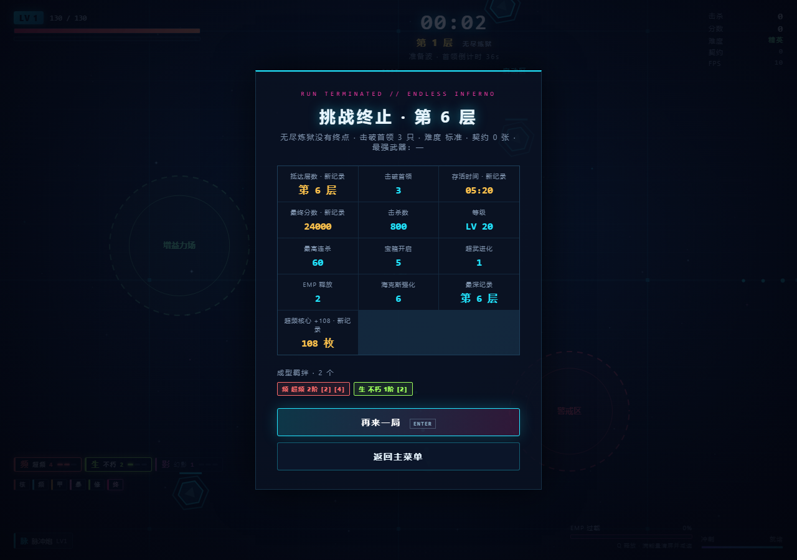
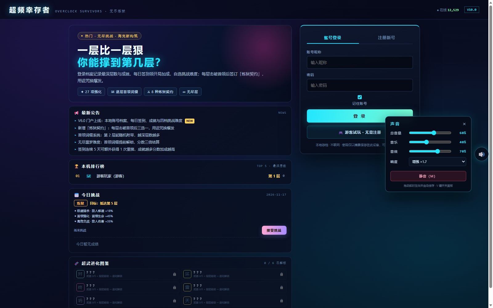
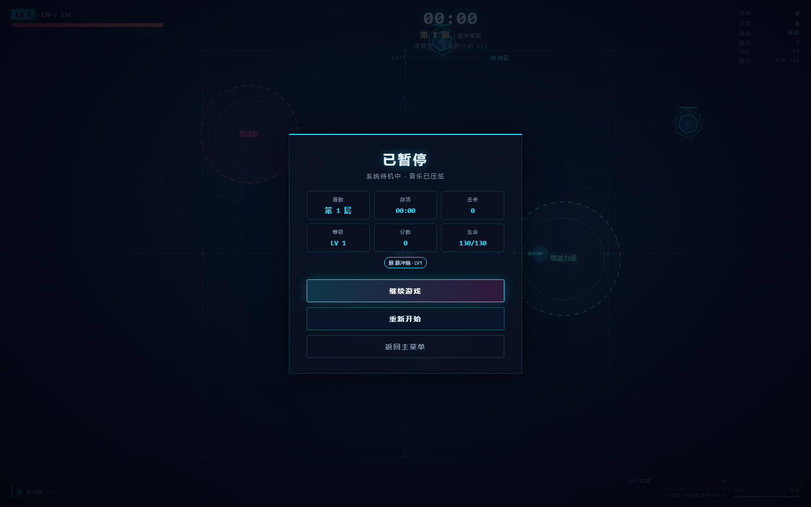
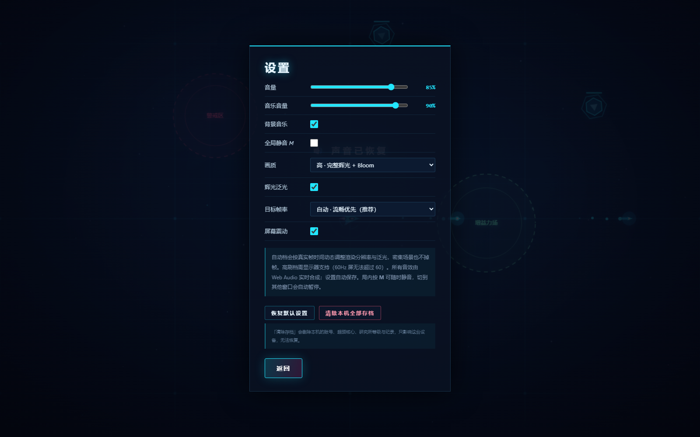

# 超频幸存者 · OVERCLOCK SURVIVORS v11.1 · 无尽炼狱

[](https://apexf-prog.github.io/overclock-survivors/)
[](https://github.com/ApexF-prog/overclock-survivors)


> **🌐 在线试玩：<https://apexf-prog.github.io/overclock-survivors/>** —— 手机 / 电脑浏览器直接打开，无需安装。

零依赖的 HTML5 Canvas 俯视角生存射击游戏。**双击 `index.html` 即可游玩** —— 不需要安装、不需要联网、不需要本地服务器、没有任何图片或音频素材文件（画面全部实时绘制，声音全部由 Web Audio 实时合成）。

v11 是**声音与打击感整改版**：程序化音频原本电平太低（音效 0.02~0.1，两级衰减后几乎听不见），这次重做整条响度链路——音效电平 ×2.6、音乐乐器 ×2.0、总线 ×2.2、压缩后 makeup ×2.2，再叠「响度三档（标准/增强/狂暴）」，默认满音量 + 狂暴；音乐从 3 首单循环扩到 **5 首 + 每首 4 段变奏**（主旋律、过门、镲片、随层数升调）；新增**全局音量按钮**（右侧悬浮，V 键开关，可分别调总音量/音乐/音效）；所有可点元素统一**点击音效 + 按压回弹 + 波纹 + 发光**；打击特效强度可切三档，默认狂暴（粒子、震屏、闪白、伤害数字全面加强）。

v10 是**体验补强版**：把「切后台会被围死」「返回主菜单后音乐消失」「设置改了存不住」这类真实问题逐条修掉，并补上暂停战术快照、首领狂暴刻度、残血心跳、M 键静音、开局操作提示、战绩一键复制与本机存档清理。核心玩法延续 v9：**帧率档位（自动/60/90/120/144）+ 动态分辨率 + 渲染负载自适应**，专治密集场景卡顿；**每日挑战**（日期确定性同题 + 独立日榜）与 **超武进化图鉴**（跨局解锁进度）；再往前是 v8 **海克斯羁绊系统**、v7 **超频研究所**、v6 **4399 风格登录门户**、v4 起为 **无尽炼狱**（一层一层往下打，每层都有首领，强度逐层递增，没有终点，只有阵亡）。

## 游戏截图

| 登录门户（每日挑战 / 进化图鉴 / 排行 / 研究所） | 游戏内 HUD（挑战进度 / 帧率 / 帧时间） |
|---|---|
|  |  |

| 海克斯强化三选一（羁绊归属标签） | 结算页（成型羁绊 / 核心收益） |
|---|---|
|  |  |

| 全局音量面板（v11 · 三路音量 + 响度三档） |
|---|
|  |

| 暂停战术快照（v10） | 设置页（v10 · 静音 / 存档管理） |
|---|---|
|  |  |

## v11.1 修复（本次）

| 问题 | 根因 | 修法 |
|---|---|---|
| 每层首领长得一模一样 | `systems.js` 的 `G.spawnBoss` 覆盖了 `game.js` 同名函数，但覆盖版漏写 `e.arch` / `e.gen`，`visuals.js` 里 `e.arch \|\| 0` 恒落到第 0 种 | 在实际生效的 `systems.js` 里按层赋值：`arch = (层-1) % 4`（巨口兽/多眼体/蛛形/蛇形），`gen = ⌊(层-1)/4⌋`，第 5 层起换世代配色 + 额外棘刺 |
| 右侧音量喇叭压住连击数字 | `.combo-box` 在 `right:24px; top:44%`，`.vol-fab` 在 `right:14px; top:50%`，两者重叠 | 喇叭缩小到 42px 并半透明，连击左移到 `right:82px`（窄屏 64px），面板同步改到 `right:62px` |

回归：冒烟测试新增「首领形态逐层轮换」断言（`arch 0→1→2→3→0→1` / `gen 0→0→0→0→1→1`），共 64 项全绿；浏览器侧在 1920×1080 ~ 640×560 共 9 种分辨率下逐一实测喇叭矩形与连击、HUD 元素零重叠。

## v11 声音 / 特效整改

### 响度：从「听不见」到「明显偏大」

| 环节 | 旧值 | 新值 | 说明 |
|---|---|---|---|
| 音效原始电平 | 0.02~0.10 | ×2.6 | `tone()/noise()` 统一乘 `SFX_BOOST` |
| 音效总线 | 1.45 | 2.2 × 音效音量 | 新增独立「音效音量」设置 |
| 音乐乐器 | 0.03~0.34 | ×2.0 | 底鼓/军鼓/踩镲/贝斯/铺底/琶音全部抬升 |
| 音乐总线 | musicVol × 1.0 | musicVol × 1.25 | 不再让子链路二次衰减 |
| 主总线 | volume × 1.15 | volume × 2.2 × 响度档 | 响度档：标准 ×1.0 / 增强 ×1.7 / 狂暴 ×2.6 |
| 动态处理 | 压缩器无补偿 | 压缩 + makeup ×2.2 | 削尖峰后整体补足，响而不破音 |

老存档会自动做一次性「响度迁移」（`loudVer: 11`），音量抬到满档，不会因为旧设置继续偏小。

### 音乐：5 首 + 段内变奏，不再单曲循环

- `menu` 78 BPM 氛围 → `battle` 132 → `battle2` 142（第 4 层起升调切分）→ `boss` 150 → `boss2` 164（第 6 层起双踩 + 半音上行）
- 每首都有 **主旋律声部**（16 步乐句、长音收尾）、**4 小节一句的过门**（军鼓滚奏 / 镲片 / 八度跳进），不再是一直重复同一句琶音
- 曲目按层数自动切换：`battleMusic(floor)` / `bossMusic(floor)`，深层首领战不再和浅层同一首

### 音量入口：任何界面都能调

- 右侧悬浮 🔊 按钮（门户、菜单、局内、结算都可见），**V** 键开关
- 面板三路独立滑块：总音量 / 音乐 / 音效，实时生效并自动保存，双击总音量回满
- 响度三档下拉 + 静音按钮，与设置页双向同步

### 所有点击都有音效和特效

- 文档级委托：`button / 强化卡 / 契约卡 / 难度卡 / 研究所行 / 图鉴格` 按下即播 `uiTap`
- 反馈：`ui-press` 回弹缩放 + `ui-ripple` 波纹 + 边缘发光 `ui-flash`
- 已有专属音效的按钮不叠加（`NS.Audio.recent(70)` 去重），悬浮另有 `uiHover`
- 新增 UI 音色：`uiTap / uiOpen / uiClose / uiHover / uiStep / uiBig / uiDeny`

### 打击特效强度三档

- `fx.power`：1 标准 / 1.5 强 / 2 狂暴（默认）
- 影响：粒子数量与尺寸、爆心冲击环、震屏幅度（上限 26 → 34）、闪白强度（0.5 → 0.62）、伤害数字字号与存活时间

## v10 体验层（10 项改进）

| # | 问题 / 缺口 | 改法 |
|---|---|---|
| 1 | 切标签页 / 最小化时游戏仍在跑，回来已经阵亡 | `visibilitychange` 自动暂停并压低音乐，回来点「继续游戏」即可 |
| 2 | 返回主菜单后音乐彻底消失（`stopMusic` 之后没人重启） | 包装 `toMenu`，回菜单即恢复 `menu` 曲目 |
| 3 | 暂停只有三个按钮，无法复盘当前构筑 | 暂停面板新增层数 / 存活 / 击杀 / 等级 / 分数 / 生命 + 武器与羁绊芯片 |
| 4 | 想安静只能进设置拖音量 | 全局 **M** 键静音（只压 master，保留音量设置），并持久化到档案 |
| 5 | 首领 50% / 22% 阶段跃迁毫无预兆 | 血条加两条阶段刻度，二阶段转橙金、三阶段红色脉冲 |
| 6 | 残血只有一层红晕，紧张感不足 | 新增心跳音效，血量越低间隔越短（0.6s → 1.2s） |
| 7 | 设置改错没法一键还原 | 「恢复默认设置」按钮（只重置音频/画质/帧率） |
| 8 | 存档只能在浏览器里手动清 | 「清除本机全部存档」+ 二次确认，明确提示只影响本机 |
| 9 | 新玩家第一局不知道该按什么 | 开局 6.5 秒操作提示，键鼠 / 触屏文案自动区分，进面板即隐藏 |
| 10 | 打出好成绩只能截图 | 结算「复制本局战绩」生成含层数/分数/击破首领/试玩链接的文案 |
| + | 门户读存档时替换了 `Save.data` 引用，UI 后续写入可能丢失 | 新增只读 `U.Save.peek()`，门户改用它；版本号统一为 V10.0 |

## 性能与帧率（v9 核心）

> 常见误区：卡顿就调高帧率上限。实际上游戏用的是 `requestAnimationFrame`，帧率本就跟显示器刷新率走；强制锁 120 会把每帧预算从 16.7ms 压到 8.3ms，密集场景反而更卡。v9 的正确做法是**降低每帧渲染负载**，让帧率自然更稳。

- **帧率档位**（设置面板）：`自动`（推荐）/ `60` / `90` / `120` / `144`。高档位是上限节流，需显示器本身支持（60Hz 屏无法超过 60）。HUD 实时显示 `实际/上限` 与帧时间（ms）。
- **动态分辨率**：自动档按真实帧时间平滑调整渲染 dpr（0.75×~1×），密集场景降低填充量，稳定后渐进恢复，避免分辨率跳变。
- **Bloom 快速路径**：高负载时泛光自动切到低分辨率 + 轻模糊分支，第 2 档性能降级时彻底关闭。
- **自适应画质**（沿用）：连续掉帧自动降级粒子上限与辉光，稳定 7 秒后逐步恢复。
- 逻辑始终锁定 60Hz 固定步长，物理稳定，与渲染帧率解耦。

## 每日挑战 + 进化图鉴（v9 · 可展示亮点）

- **每日挑战**：以本地日期为种子确定性生成——同一天所有账号同题（1 个难度 + 目标层数 + 3 条修饰规则，如「EMP 封锁」「玻璃大炮」「刷怪密度 +25%」）。门户可查看今日规则并一键接受挑战，HUD 显示目标进度。
- **独立日榜**：每天成绩单独存档（与本机总榜隔离），每账号每天只保留最好成绩，达标标记 ✓。
- **超武进化图鉴**：跨局记录进化过的 6 件超武，未解锁显示占位，已解锁显示效果说明与进度 `N/6`。

> 目录名与游戏名一致：`OverclockSurvivors` ↔ `OVERCLOCK SURVIVORS`。

## 玩法

移动躲避、武器全自动开火、拾取经验晶体升级，每次升级从 **三张海克斯强化卡** 中选一张构筑这一局。每层先打一段准备波，时间到**强制出现该层首领**；击破首领才进入下一层，越往下越难。

| 操作 | 按键 |
| --- | --- |
| 移动 | `WASD` / `方向键` / 触屏左侧摇杆 |
| 冲刺（无敌 + 撞开敌群） | `SPACE` / 触屏右下按钮 |
| EMP 过载（能量满时清屏） | `Q` / 触屏紫色按钮 |
| 升级三选一 | `1` `2` `3` 或直接点击卡片 |
| **重掷三张强化（每局 2 次）** | `R` 或点击卡片下方按钮 |
| 暂停 | `P` / `ESC` |
| 开始 / 再来一局 | `ENTER` |

## 海克斯羁绊（v8 核心 · 局内构筑深度）

强化不再各自为战——每拿一种强化，都在为某个羁绊充能。这是云顶之弈 / 金铲铲 / LoL 海克斯最上瘾的构筑机制：

- **6 大羁绊**：超频（输出）、不朽（续航）、军械（弹幕）、引力（资源）、奇点（领域）、幻影（暴击连锁）。一个强化可同时归属多个羁绊。
- **按「种类数」计数**：同一种强化叠多层只算 1 件，逼你拿不同的强化来凑羁绊，鼓励构筑多样性而不是无脑叠一个。
- **2 / 4 / 6 件三档阶梯**：每跨一档触发一次强效加成（如超频 2 件伤害 +14%、4 件攻速暴击、6 件伤害再 +35%；不朽 6 件解锁"濒死免疫"，每 30 秒一次）。
- **实时反馈**：HUD 左侧羁绊栏显示已投入羁绊的件数与激活档位（点亮圆点）；升级选择卡标注每张卡的羁绊归属与距离激活还差几件；结算页展示本局成型羁绊。
- **单调递增不漂移**：档位效果只在新跨档时叠加一次并记账，重复计算不会导致属性数值失控。

## 超频研究所（v7 核心 · 元成长）

这是让每一局都有积累的永久成长线，类似 4399 热门游戏的「成长系统」：

- **产出**：每局结算按 `层数×3 + 首领×6 + 击杀/40 + 分数/1500 + 存活分钟` 结算「超频核心」，再乘难度倍率（标准 ×1 → 无尽噩梦 ×3）。打得越深、越难，核心越多。
- **消费**：登录后在门户卡片点「⚗ 研究所」展开面板，用核心购买 6 项永久升级，每项多级、价格逐级递增：
  | 升级 | 效果 |
  | --- | --- |
  | 生命矩阵 | 初始生命 +18 / 级（6 级） |
  | 超频核心 | 全局伤害 +6% / 级（6 级） |
  | 精准校准 | 暴击率 +3% / 级（5 级） |
  | 纳米修复 | 每秒回血 +0.2 / 级（5 级） |
  | 能量电容 | 开局能量 +14% / 级（5 级） |
  | 幸运回路 | 分数 +6% / 级 · 每 2 级开局重掷 +1（4 级） |
- **生效**：永久升级在开局注入，对所有账号档案各自独立存档（游客也有档案），与难度、签到加成叠加。
- **存档**：核心数量与升级等级存在 `localStorage` 的账号档案里，不联网、换浏览器不同步。

## 无尽炼狱（v4 核心）

### 层循环

```
第 N 层 · 准备波（42s 起，逐层缩短至最低 26s）
   → 全屏首领警报 + 常驻血条 + 警示音
   → 首领战（击破才结束）
   → 回血 28% / 补能量 45 / 稀有宝箱 / 分数奖励
   → 第 N+1 层（敌群与首领强化，场景配色循环）
```

HUD 顶部显示当前层数与本层状态：准备波显示「首领倒计时」，首领战显示「击破后进入下一层」；阶段条在准备波表示距首领进度，在首领战表示首领已削血量。

### 逐层强度曲线

敌人基础表保持温和（首领 1000 HP / 46 速 / 18 伤），**所有强度由层系数注入**，这样第 1 层不劝退、后期指数级加压：

| 层 | 首领 HP | 首领弹幕 | 小怪 HP 系数 | 小怪伤害系数 | 场上数量上限 |
| --- | --- | --- | --- | --- | --- |
| L1 | 2,200 | 12 发 / 175 速 | ×1.00 | ×1.00 | 100 |
| L3 | 5,647 | 递增，扇形扩到 7 发 | ×2.96 | ×1.52 | 110 |
| L6 | 12,283 | 上限 32 发 / 340 速 | ×6.33 | ×2.30 | 125 |
| L10 | ≈22,700 | 高频弹幕 + 10 只召唤 | ×11.3 | ×3.34（封顶） | 140 |

- 首领血量：`2.2 + (f-1)×1.15 + (f-1)^1.45×0.42` 倍；伤害 / 移速 / 体积 / 召唤量 / 弹幕频率同步成长
- 小怪统一走 `NS.floorScale(f)`（HP / 移速 / 接触伤害），刷怪、分裂体、首领召唤的小怪共用同一曲线
- 首领半血、残血各进一个狂暴阶段，**跃迁瞬间爆发整圈弹幕 + 闪白 + 震屏**
- **首领单次受伤上限 = 最大生命的 3.5%**（暴击同样受限），后期超高 DPS 也不会把 BOSS 瞬秒到看不见

### 首领一定会看到

- **全屏红色警报横幅**：`⚠ WARNING // FLOOR N BOSS` + 首领名字 + 血量 + 强度倍率 + 「一层比一层强」
- **三连警示音**（`warning` 音效）+ 原有低沉 `boss` 音
- **常驻 BOSS 血条**：`L层数` 标签、名字、剩余 HP 百分比、掉血进度
- **屏外方向箭头**（带距离），配合战前的决斗领域推开一圈小怪、6 秒压制刷怪

### 结算

没有「生存成功 / 通关」。只有阵亡，结算标题为「挑战终止 · 第 N 层」，核心指标是 **抵达层数** 与 **击破首领数**；菜单与结算都会记录「最深第 N 层」新纪录。

## 海克斯强化（27 项 · 银 / 金 / 棱彩）

- **银色 · COMMON（12 项）**：超频核心、冷却矩阵、疾行引擎、装甲镀层、引力场、数据解析、弱点扫描、纳米修复、分裂协议、能量护盾、军械解锁、武器校准
- **金色 · RARE（9 项，机制质变）**：
  - `全域牵引` — 自动吸附全屏经验晶体 / 宝箱 / 地面道具（可叠 3 层）
  - `血契协议` — 每次击杀回血，精英 ×3、首领 ×12
  - `力场共鸣` — 增益力场额外回血 + 持续充能 EMP
  - `脉冲护环` — 周期性自动爆发冲击波，击退贴身敌群
  - `超载电芯` — EMP 能量 ×1.8、过载伤害 +40%
  - `寻宝协议` — 击杀概率掉宝箱，宝箱奖励条数提升
  - `超武蓝图` — 直接把 LV3+ 武器进化，无需凑指定被动
  - `噬能回路` — 造成伤害按比例转化为生命
  - `贪婪回路` — 分数 ×1.4、经验 +20%
- **棱彩 · PRISMATIC（6 项）**：奇点领域、绝对过载、军火协议、不死协议、连锁湮灭、终焉同调

**构筑规则**：品质概率随等级提升（后期棱彩最高 20%）；已持有的强化让相关强化权重翻倍并显示「协同」；连续 6 次没出棱彩则保底必出；每局可 `R` 重掷 2 次。

## 难度平衡：历次实机反馈对照

| 反馈 | 处理 |
| --- | --- |
| 第三关围攻很乱、时不时卡顿 | 刷怪间隔下限 0.85s、按场上存活数动态限流（上限 260→100，高层最多 140）、分裂体 2→1；命中数字/火花/音效按密度节流、屏外剔除、`shadowBlur` 收敛、**自适应画质**（掉帧自动降粒子/辉光/Bloom） |
| BOSS 靠近不了、被小怪磨死 | 生成距离 0.60→0.45 屏对角、基础生命 100→130、基础回复 0→0.4/s、无敌帧 0.65→0.85s、冲刺撞开敌群 |
| 增益磁场没感觉 | 圈内回血 4→9/s、攻速 ×0.82→×0.72、伤害 ×1.18、EMP 持续充能 |
| 想要自动拾取 / 恢复快 / 吸血 | `全域牵引`、纳米修复 / 不死协议、`血契协议`（击杀回血）+ `噬能回路`（命中回血），均保留 |
| **BOSS 太弱、小怪太弱、一直爽** | 取消 5 分钟判胜 → 无尽层；首领与小怪强度逐层递增；基础能量获取 3.2→**1.7**、`绝对过载` 自动 EMP 加 **10 秒冷却**且回充 40→12（实测 EMP 从 95 次降到约 10 次）；升级无敌 0.7→0.4s；决斗领域 12s→**6s** 且不再清光小怪 |
| **BOSS 我都没看到** | 全屏警报横幅 + 三连警示音 + 常驻血条 + 屏外箭头 + 首领单次受伤上限 + 阶段跃迁弹幕爆发 |
| **要无尽、每层都有 BOSS、BOSS 出现给提示** | 层状态机（准备波 → 首领战 → 击破进下一层），层数无上限；每层必出且逐层更强 |

## 原有内容

- **6 件武器**：脉冲炮、环绕光刃、贯穿激光、闪电链、冲击新星、追踪导弹，各 8 级；6 种超武进化
- **5 套场景配色**：启动区 → 光栅回廊 → 熔核地带 → 深蓝静域 → 终焉协议，按层循环
- **5 种随机事件**：数据洪流、晶体雨、猎杀指令、超频领域、电磁风暴
- **10 类敌人**：直冲 / 高速 / 重甲 / 绕行 / 远程 / 分裂 / 分裂体 / 冲锋兵 / 自爆兵 / 护盾兵，加 5 种首领名按层循环
- **地图互动**：可击破数据核心、增益力场 / 警戒区、地面道具、宝箱；每层通关必投稀有宝箱
- **存档**：`localStorage` 保存最高分 / 最深楼层 / 最长存活 / 累计击杀 / 设置
- **视听**：Canvas 辉光、Bloom、阶段化星云背景、全物体重绘、分级顿帧 / 方向震屏 / 白闪 / 电弧；Web Audio 实时合成全部音效与 BGM
- **设置**：音量、画质（高/中/低）、Bloom 开关、屏幕震动；触屏虚拟摇杆 + 冲刺 / EMP 按钮

## 工程结构

```
OverclockSurvivors/
├── index.html          界面结构、HUD、层数 / 警报横幅、强化面板、帮助说明
├── style.css           品质化 UI、无尽 HUD 与警报样式、响应式布局
├── js/
│   ├── core.js         数学工具、对象池、空间哈希、输入、存档（含 bestFloor）
│   ├── audio.js        Web Audio 程序化音效 / BGM（含 warning 三连警报）
│   ├── fx.js           粒子、冲击环、方向震屏、闪白、镜头推近
│   ├── entities.js     数据表、玩家、敌人 AI（首领按 fs 缩放）、NS.floorScale 曲线
│   ├── content.js      进化、事件、场景、奖励、道具、新敌人
│   ├── game.js         状态机、固定时间步、战斗与碰撞、渲染核心、首领伤害上限
│   ├── visuals.js      Bloom、阶段背景、全物体重绘、威胁指示
│   ├── systems.js      无尽层状态机、刷怪/首领、连杀、EMP、宝箱、事件、地图物件、性能治理
│   ├── augments.js     海克斯强化池、品质抽取、协同、吸血/拾取/领域等机制
│   ├── synergy.js      v8 海克斯羁绊：6 大羁绊 × 3 档阶梯、种类计数、濒死免死
│   ├── account.js      v6 本地多档案账号、签到、成就、排行榜、难度倍率
│   ├── lab.js          v7 超频核心结算、6 项研究所永久升级树
│   ├── meta.js         v6/v7 难度 · 契约 · 词缀 · 永久升级开局注入的包装层
│   ├── daily.js        v9 每日挑战（日期确定性 / 日榜）与超武进化图鉴
│   ├── perf.js         v9 帧率档位 / 动态分辨率 / Bloom 快速路径 / 帧时监测
│   ├── portal.js       4399 风格登录门户交互（公告 / 排行 / 登录 / 研究所 / 每日挑战 / 图鉴）
│   └── ui.js           DOM 界面、设置、存档、触屏、重掷、警报横幅、无尽结算
├── tests/smoke.js      Node 无头冒烟测试（含无尽层探针与高压场景）
├── tests/boss_balance.js 首领强度回归（血量曲线 / 交战时长 / 高等级强化池）
├── tests/cdp_v7.js     Edge 真浏览器验证（门户 / 研究所 / 结算）
├── tests/cdp_v8.js     Edge 真浏览器验证（羁绊 HUD / 卡片标签 / 结算展示）
├── tests/cdp_perf.js   Edge 真浏览器性能验证（档位 / 帧时 / 密集场景）
├── tests/cdp_v9.js     Edge 真浏览器验证（每日挑战 / 图鉴 / 帧率设置 / HUD）
├── tests/cdp_v10.js    Edge 真浏览器验证（暂停快照 / 狂暴血条 / M 静音 / 开局提示）
└── tests/cdp_v11.js    Edge 真浏览器验证（5 首曲目 / 音量面板 / 点击反馈 / 特效档位）
（cdp 脚本均需手动启动 Edge --headless --remote-debugging-port=9226~9228）
```

`visuals.js` / `systems.js` / `augments.js` 依次通过「保存原函数 + 包装原型方法」接入，核心状态机保持在 `game.js`，各层可独立关闭。

实现要点：固定 60Hz 时间步 + 帧累加器、空间哈希碰撞剪枝、粒子对象池、敌人分离力、`file://` 下 `localStorage` 容错、音频异常与逻辑隔离、画质档与自适应降级真实影响渲染负载。

## 验证

```bash
cd OverclockSurvivors
for f in js/*.js tests/smoke.js; do node --check "$f" || exit 1; done
node tests/smoke.js
```

`tests/smoke.js` 用最小 Canvas mock 在 Node VM 里跑 **95 秒 / 5700 帧**主循环 + **195 秒零输出高压场景** + **无尽层独立探针**，随机种子已固定（结果可复现）。断言包括：

- 时间、击杀、升级链路、首领、随机事件、宝箱、超武、EMP、连杀、地图物件、渲染管线
- 海克斯池 35 项 / 四品质齐备 / 三选一结构 / 棱彩保底 / 重掷 / 全域牵引 / 击杀吸血
- **无尽回归**：无 5 分钟胜利结算、层状态机、首领逐层变强（L1 2200 → L6 12283 HP）、小怪逐层变强、首领不被瞬秒、`bossIncoming` 警报事件、击破进下一层、HUD 含 `floor / floorState / bossKills / endless`
- **195 秒完全不杀敌的峰值敌人数 ≤ 140**（实测 100，旧版上限 260）
- 自适应画质档位、**HUD 快照字段完整**（回归防护：`getHud` 每帧被调用，抛错会停掉整个渲染循环）
- **v7 元成长**：核心结算产出、研究所升级购买与价格递增、永久升级开局注入、余额不足拦截、6 项升级表完整
- **v8 羁绊**：羁绊表结构、按种类数计数（非层数）、2/4 件阶梯激活加成、重复计算不漂移、快照供 HUD、不朽濒死免疫
- **v9 性能**：5 档帧率切换（120 节流 / auto 不限）、帧时间采样与 HUD 字段
- **v9 每日挑战**：日期确定性（同日同题 / 异日异题）、修饰注入且不污染全局难度、日榜上报与读取、进化图鉴跨局记录
- **v10 体验层**：版本号、首领阶段刻度、暂停快照 6 格 + 构筑芯片、M 静音与持久化、开局提示自动隐藏、清理存档入口、零 JS 异常
- **v11 声音/特效**：曲目数 5、按层切换 battle→battle2 / boss→boss2、音量面板开合、三路音量实时生效并落盘、响度档位、点击触发 `uiTap` + `ui-press`/`ui-ripple`、特效档位与持久化
- 无 NaN / Infinity、敌人/子弹/粒子数量不越界、首领基础数值温和

浏览器端另有 `tests/cdp_v7.js`（原生 WebSocket + Edge `--headless --remote-debugging-port=9226`），验证门户渲染、注册、研究所展开/购买、结算产核心与截图，无需任何 npm 包。

当前结果：**64 项全部通过**（另有 v7~v11 五个浏览器验证脚本），连跑两次输出逐字一致。真实浏览器（Edge headless + CDP，正常 rAF）复验零 JS 异常：菜单、层数 HUD、L1 警报、常驻血条、击破进 L2、L3 首领 5647 HP、L5 高压自动降到第 2 档、无尽结算、暂停快照、狂暴血条换色、M 静音往返、布局越界、`autotest=1`、480×700 窄屏。

浏览器里也可访问 `index.html?autotest=1` 自动开局，隐藏元素 `#autotest-out` 输出实时快照（含 `floor / floorState / bossKills / hex / perf`）。该模式用 `manualTick` 自驱动，规避 headless 虚拟时间下 `requestAnimationFrame` 不推进的问题。

> 注意：`--virtual-time-budget` + `--disable-gpu` 下 rAF / CSS 时钟不推进，截图会假黑屏，不是代码 bug；真实画面需用 CDP 会话抓图。

## v5 改动（首领强度 + 无尽强化层）

针对「后期无敌、首领一出场就被秒、海克斯抽空只剩紧急修复」三个问题：

**1. 首领血量改为「指数基准 × 实测输出包络」**

- 指数基准 `2.2 × 1.32^(层-1)`，保证低层也有成长曲线；
- 用玩家实测 DPS（`emaDps`，约 3 秒指数滑动平均）夹出区间：血量落在 `DPS × 目标时长 × 0.30 ~ 0.52` 之间；
- 目标时长 `wantSec = min(26, 10 + 层)`，越深越久；
- 同局内每层至少 `+12%`，玩家输出原地踏步时首领也会缓慢变强；
- 奖励（经验/分数）随血量同步成长，避免「打半天只掉几颗宝石」。

**2. 用「每秒伤害闸门」取代原来的「单次受伤 3.5% 上限」**

旧逻辑是单次伤害 ≤ 3.5% 最大生命，等于**打中 29 下必死**——血量再厚都没意义，多弹体一叠就是秒杀。现在改为每只首领带 `maxDps = maxHp / (wantSec × 1.15)` 的秒伤预算，超出的伤害本帧不结算，血量才真正决定交战时长。

**3. 修掉两处「绕过伤害直接抹杀」的路径**

- 炸弹道具 `screenBomb` 原来对首领直接 `killEnemy`，改成按血量 6% 重击；
- 高等级下 EMP 满能量自动连放，配合割草可反复清场，故首领伤害统一走 `damageEnemy` 受闸门约束。

**4. 新增「无尽」强化层（8 种，上限 99 层）**

原先全局只有 27 种强化、合计 102 次上限，LV100 之后池子被抽干，三张卡全变成「紧急修复」。现在银/金/棱彩抽空后依次下探到无尽层，保证任何等级都有三张**互不相同**的真强化；保底卡也从三张相同改为修复/灌注/溢出三种。

**实测（`node tests/boss_balance.js`）**

| 场景 | 改前 | 改后 |
|---|---|---|
| 满配 LV108 · 第 18 层 | 2–4 秒击杀 | 约 30 秒（12 秒剩 69% 血） |
| 普通玩家 · 第 6 层 | 数秒 | 约 21 秒 |
| LV108 三选一 | 三张「紧急修复」 | 三张不同的无尽强化 |

`tests/boss_balance.js` 断言：血量随层单调递增、血量能被 DPS 追平、满配不秒杀（≥8s）、深层交战 ≤70s、普通玩家不失控（<90s）、池子抽空后仍有真强化、无尽层可连续叠加 200 次且数值有限。
